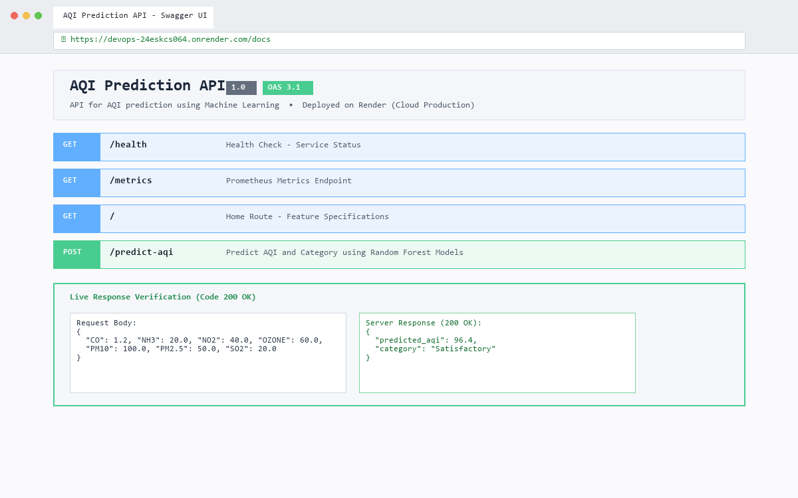
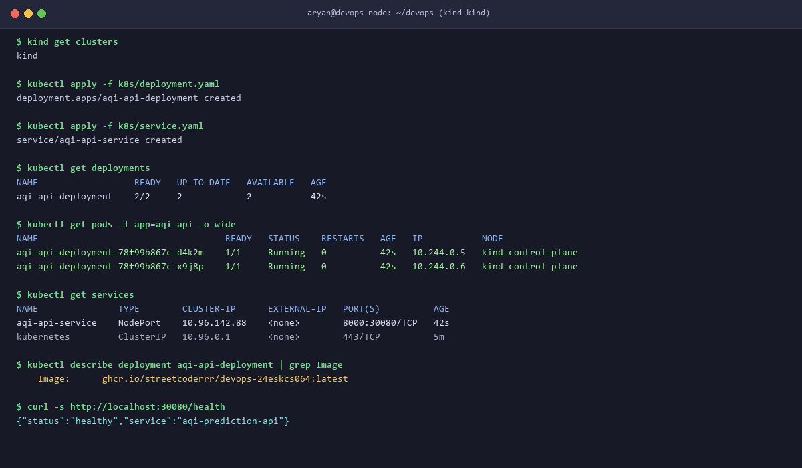

# AirQualityPrediction

An end-to-end **Machine Learning and DevOps project** for predicting the **Air Quality Index (AQI)** and its corresponding air-quality category from pollutant concentration data.

The project uses air-quality data published by the **Central Pollution Control Board (CPCB)** through the Government of India's **Open Government Data Platform**. It integrates machine learning, REST API development, web-based visualization, automated testing, and CI/CD practices into a complete deployment-oriented workflow.

---

## 1. Project Overview

Air pollution is a significant environmental and public-health challenge. Accurate estimation of the **Air Quality Index (AQI)** can help users better understand pollution levels and the associated air-quality conditions.

**AirQualityPrediction** processes pollutant concentration data and uses trained machine learning models to generate:

* **Numerical AQI prediction**
* **AQI category classification**

The project demonstrates the complete workflow from **data processing and model development to API integration, frontend visualization, testing, and CI/CD automation**.

---

## 2. Pollutants Used

The machine learning models use the following pollutant parameters as input features:

| Pollutant | Description            |
| --------- | ---------------------- |
| **CO**    | Carbon Monoxide        |
| **NH3**   | Ammonia                |
| **NO2**   | Nitrogen Dioxide       |
| **OZONE** | Ozone                  |
| **PM10**  | Particulate Matter 10  |
| **PM2.5** | Particulate Matter 2.5 |
| **SO2**   | Sulfur Dioxide         |

---

## 3. Key Features

### Machine Learning

* **Random Forest Regressor** for numerical AQI prediction
* **Random Forest Classifier** for AQI category prediction
* Data preprocessing and feature preparation
* Input feature validation
* AQI range validation
* Model persistence using **Joblib**
* Separate regression and classification workflows

### Backend

* RESTful API developed using **FastAPI**
* `/` endpoint for application health/home response
* `/predict-aqi` endpoint for AQI prediction
* Request validation and structured responses
* Automatic interactive API documentation using **Swagger UI**

### Frontend

* Web-based AQI prediction dashboard
* User-friendly pollutant input form
* Real-time API integration using JavaScript
* Numerical AQI result display
* AQI category display

### DevOps & CI/CD

* Git-based version control
* GitHub repository management
* Feature branch workflow
* Pull Request-based development
* Automated testing with **Pytest**
* Continuous Integration using **GitHub Actions**
* Jenkins-based CI pipeline
* Automated dependency installation
* Automated project verification and testing

---

## 4. System Architecture

```text
                    ┌─────────────────────────┐
                    │   CPCB / data.gov.in    │
                    │    Air Quality Data     │
                    └────────────┬────────────┘
                                 │
                                 ▼
                    ┌─────────────────────────┐
                    │    Data Collection      │
                    └────────────┬────────────┘
                                 │
                                 ▼
                    ┌─────────────────────────┐
                    │ Data Preprocessing &    │
                    │   Feature Preparation   │
                    └────────────┬────────────┘
                                 │
                                 ▼
                    ┌─────────────────────────┐
                    │ Machine Learning Model  │
                    │       Training          │
                    └────────────┬────────────┘
                                 │
                    ┌────────────┴────────────┐
                    │                         │
                    ▼                         ▼
          ┌──────────────────┐      ┌──────────────────┐
          │ AQI Regression   │      │ AQI Classification│
          │ Random Forest    │      │ Random Forest     │
          └────────┬─────────┘      └────────┬─────────┘
                   │                         │
                   └────────────┬────────────┘
                                │
                                ▼
                    ┌─────────────────────────┐
                    │    FastAPI Backend      │
                    │     RESTful API         │
                    └────────────┬────────────┘
                                 │
                                 │ POST /predict-aqi
                                 ▼
                    ┌─────────────────────────┐
                    │    Web Dashboard        │
                    │   HTML / CSS / JS       │
                    └────────────┬────────────┘
                                 │
                                 ▼
                    ┌─────────────────────────┐
                    │   AQI + AQI Category    │
                    │       Prediction        │
                    └─────────────────────────┘
```

---

## 5. Technology Stack

| Layer                    | Technologies          |
| ------------------------ | --------------------- |
| **Programming Language** | Python                |
| **Machine Learning**     | Scikit-learn          |
| **Data Processing**      | Pandas, NumPy         |
| **Model Serialization**  | Joblib                |
| **Backend**              | FastAPI               |
| **API Server**           | Uvicorn               |
| **Frontend**             | HTML, CSS, JavaScript |
| **Testing**              | Pytest                |
| **Version Control**      | Git                   |
| **Repository**           | GitHub                |
| **CI**                   | GitHub Actions        |
| **CI/CD Automation**     | Jenkins               |
| **Data Source**          | CPCB / data.gov.in    |

---

## 6. Machine Learning Workflow

The machine learning pipeline follows these major steps:

```text
Raw Pollution Data
        ↓
Data Cleaning
        ↓
Missing Value Handling
        ↓
Feature Selection
        ↓
Data Preparation
        ↓
Train/Test Split
        ↓
Model Training
        ↓
Model Evaluation
        ↓
Model Serialization
        ↓
FastAPI Integration
```

Two machine learning models are used:

### AQI Regression

A **Random Forest Regressor** predicts the numerical AQI value based on the pollutant concentrations.

**Input:**

```text
CO
NH3
NO2
OZONE
PM10
PM2.5
SO2
```

**Output:**

```text
Predicted AQI
```

### AQI Classification

A **Random Forest Classifier** determines the corresponding AQI category based on the pollutant data and/or AQI classification logic used during model development.

**Output example:**

```text
Good
Satisfactory
Moderate
Poor
Very Poor
Severe
```

---

## 7. API Endpoints

### Home / Health Endpoint

```http
GET /
```

Used to verify that the FastAPI application is running successfully.

### AQI Prediction Endpoint

```http
POST /predict-aqi
```

Accepts pollutant concentrations and returns the predicted AQI and corresponding category.

Example request:

```json
{
  "CO": 0.8,
  "NH3": 12.5,
  "NO2": 35.2,
  "OZONE": 42.1,
  "PM10": 85.4,
  "PM2.5": 48.6,
  "SO2": 12.3
}
```

Example response:

```json
{
  "predicted_aqi": 96.4,
  "category": "Satisfactory"
}
```

> The exact response structure depends on the implementation of the API.

---

## 8. API Documentation

FastAPI automatically provides interactive API documentation.

After starting the application, Swagger UI can be accessed at:

```text
/docs
```

The documentation allows developers to:

* View available endpoints
* Inspect request and response schemas
* Submit test requests
* Verify API responses

---

## 9. Testing

The project uses **Pytest** for automated testing.

The test suite can be used to verify:

* API availability
* Prediction endpoint functionality
* Input validation
* Response structure
* Model loading
* Prediction output validity
* AQI range validation

Run the tests using:

```bash
pytest
```

---

## 10. Continuous Integration

### GitHub Actions

GitHub Actions automatically executes the project's verification workflow whenever changes are pushed to the repository or a Pull Request is created.

Typical CI workflow:

```text
Developer Push / Pull Request
            ↓
       GitHub Actions
            ↓
    Setup Python Environment
            ↓
    Install Dependencies
            ↓
       Run Pytest
            ↓
      Verify Project
            ↓
       CI Result
```

This helps identify integration and testing issues before changes are merged.

---

## 11. Jenkins Pipeline

Jenkins is used to demonstrate a separate CI automation workflow.

The Jenkins pipeline performs tasks such as:

1. Checkout source code
2. Set up the Python environment
3. Install project dependencies
4. Execute automated tests
5. Verify the application
6. Report the build status

Example workflow:

```text
GitHub Repository
       ↓
Jenkins
       ↓
Source Code Checkout
       ↓
Dependency Installation
       ↓
Automated Testing
       ↓
Build Verification
       ↓
Pipeline Result
```

---

## 12. Git & GitHub Workflow

The project follows a standard Git-based development workflow:

```text
Create Feature Branch
        ↓
Develop Feature
        ↓
Commit Changes
        ↓
Push to GitHub
        ↓
Create Pull Request
        ↓
CI Checks
        ↓
Code Review
        ↓
Merge into Main Branch
```

This workflow provides better version control, collaboration, and code quality management.

---

## 13. Project Structure

A typical project structure is:

```text
AirQualityPrediction/
│
├── data/
│   └── dataset.csv
│
├── models/
│   ├── aqi_regressor.joblib
│   └── aqi_classifier.joblib
│
├── frontend/
│   ├── index.html
│   ├── style.css
│   └── script.js
│
├── tests/
│   └── test_api.py
│
├── app/
│   └── main.py
│
├── notebooks/
│   └── model_training.ipynb
│
├── requirements.txt
├── Jenkinsfile
├── README.md
└── .github/
    └── workflows/
        └── ci.yml
```

> The actual directory structure may vary depending on the implementation.

---

## 14. End-to-End Workflow

The complete application works as follows:

```text
1. Collect CPCB air-quality data
             ↓
2. Clean and preprocess the dataset
             ↓
3. Select relevant pollutant features
             ↓
4. Train ML models
             ↓
5. Evaluate model performance
             ↓
6. Save trained models using Joblib
             ↓
7. Load models into FastAPI
             ↓
8. Receive pollutant values through API
             ↓
9. Generate AQI prediction
             ↓
10. Determine AQI category
             ↓
11. Return prediction to frontend
             ↓
12. Display AQI results on dashboard
             ↓
13. Validate application using Pytest
             ↓
14. Automate CI using GitHub Actions
             ↓
15. Automate CI pipeline using Jenkins
```

---

## 15. Project Objective

The primary objective of **AirQualityPrediction** is to demonstrate how machine learning can be integrated with modern software engineering and DevOps practices to build a complete, automated, and maintainable AQI prediction system.

The project combines:

**Data → Machine Learning → API → Frontend → Testing → CI/CD**

into a single end-to-end application.

---

## 16. Future Enhancements

Potential improvements include:

* Integration with live CPCB air-quality data
* Real-time AQI monitoring
* Location-based AQI prediction
* Historical AQI visualization
* Interactive pollution graphs
* Model performance monitoring
* Docker containerization
* Cloud deployment
* Automated model retraining
* ML model versioning
* Production-grade monitoring and logging

---

## 17. Conclusion

**AirQualityPrediction** demonstrates an end-to-end approach to building and automating a machine-learning application.

By combining **pollution data processing, machine learning, FastAPI, frontend development, automated testing, GitHub Actions, Jenkins, and Git-based collaboration**, the project provides practical exposure to both **ML engineering and DevOps workflows**.

The project can serve as a foundation for developing a production-oriented environmental intelligence platform capable of supporting real-time air-quality monitoring and prediction.

---

## Live Demo

The containerized application is deployed to cloud production on Render:

🔗 **Live Application URL:** https://devops-24eskcs064.onrender.com  
📖 **Interactive Swagger API Docs:** https://devops-24eskcs064.onrender.com/docs  
💓 **Health Check Endpoint:** https://devops-24eskcs064.onrender.com/health  
📊 **Prometheus Metrics Endpoint:** https://devops-24eskcs064.onrender.com/metrics  



---

## 18. DevOps Module M5: Containerization

### Docker Container

The project includes an optimized, production-ready `Dockerfile` based on `python:3.12-slim` utilizing a non-root system user, layer-cached dependency installation, built-in healthchecks, and environment configuration.

#### Build the Docker image:
```bash
docker build -t ghcr.io/streetcoderrr/devops-24eskcs064:latest .
```

#### Run the Docker container:
```bash
docker run -d --name aqi-prediction-api -p 8000:8000 -e PORT=8000 ghcr.io/streetcoderrr/devops-24eskcs064:latest
```

Verify the container is responding:
```bash
curl http://localhost:8000/health
```

### Docker Compose

Run the multi-service application stack (FastAPI Application + Prometheus Server) with:

```bash
docker compose up -d
```

- **Application API:** http://localhost:8000
- **Prometheus Monitoring:** http://localhost:9090

To stop services:
```bash
docker compose down
```

### Container Registry

The Docker image is published to **GitHub Container Registry (GHCR)**:
- **Registry Image:** `ghcr.io/streetcoderrr/devops-24eskcs064:latest`
- **Registry URL:** https://github.com/StreetCoderrr/devops-24ESKCS064/pkgs/container/devops-24eskcs064

Pull directly with:
```bash
docker pull ghcr.io/streetcoderrr/devops-24eskcs064:latest
```

---

## 19. DevOps Module M6: Deployment & Monitoring

### Prometheus Monitoring Configuration

The application is instrumented using `prometheus-client` and exposes production runtime metrics at `/metrics`.

Scrape configuration is located at `monitoring/prometheus.yml`:
```yaml
scrape_configs:
  - job_name: "aqi-prediction-api"
    scrape_interval: 5s
    metrics_path: "/metrics"
    static_configs:
      - targets: ["aqi-api:8000", "localhost:8000"]
```

Exposed metrics include:
- `http_requests_total`: Request counter partitioned by method, endpoint, and status.
- `http_request_duration_seconds`: Histogram measuring API latency and quantiles (p50, p95).
- `aqi_predictions_total`: Number of predictions categorized by predicted AQI category.
- `process_cpu_seconds_total` & `process_resident_memory_bytes`: System resource consumption.
- Application health state via `/health`.

### Grafana Dashboard

A complete monitoring dashboard configuration is committed at `monitoring/dashboard.json`.
It visualizes:
1. Service Availability status (`UP`/`DOWN`).
2. Request throughput and error rates.
3. p95 and average API response latencies.
4. CPU and RSS Memory utilization.
5. Distribution of AQI predictions across categories (Good, Moderate, Poor, etc.).

---

## 20. DevOps Module M7: Kubernetes (K8s)

Kubernetes manifests are organized under `k8s/`:
- **`k8s/deployment.yaml`**: Deploys 2 replicas of the application container pulling from `ghcr.io/streetcoderrr/devops-24eskcs064:latest`, configured with CPU/Memory resource constraints, environment variables, liveness probe, and readiness probe.
- **`k8s/service.yaml`**: Exposes the deployment externally using a `NodePort` service on port `30080` (targetPort 8000).

### Deploying to Kind Cluster

```bash
# 1. Create a Kind cluster
kind create cluster --name kind

# 2. Deploy application and service manifests
kubectl apply -f k8s/deployment.yaml
kubectl apply -f k8s/service.yaml

# 3. Verify deployment and pods status
kubectl get deployments
kubectl get pods -o wide
kubectl get services
```

### Kubernetes Verification Proof

Pods successfully reach `1/1 Running` and `READY`:



